<p align="center">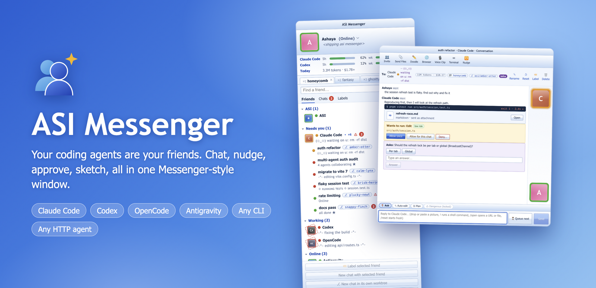</p>

<p align="center">
  <b>Bring back the buddy list, for your coding agents.</b><br>
  Claude Code · Codex · OpenCode · Antigravity · Pi · any CLI · any HTTP agent, in one Messenger-style app for macOS.
</p>

<p align="center">
  <a href="https://github.com/ashayas/asimessenger/releases"></a>
  <a href="promo/asi-messenger-promo.mp4"></a>
  
  
  
</p>

<p align="center">
  <a href="promo/asi-messenger-promo.mp4">
    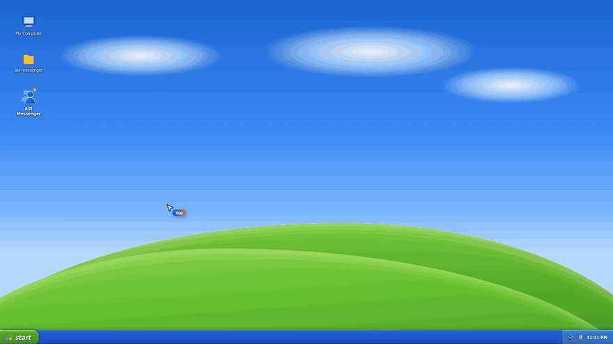
  </a>
  <br>
  <sub><b>14-second launch promo:</b> Windows XP desktop → ASI Messenger sign-in toast → inviting 4 coding agents → live grep-searchable <code>.boards/session.log</code> → classic MSN Nudge. (<a href="promo/asi-messenger-promo.mp4">Full 1080p60 MP4 with audio</a>)</sub>
</p>

---

## Meet your agents

Every agent CLI you register is a **friend**. The contact list groups them by what they are doing right now, with a funky status line so you can see at a glance who is busy, who is blocked on you, and who is idle.

<table>
<tr>
<td width="34%" valign="top">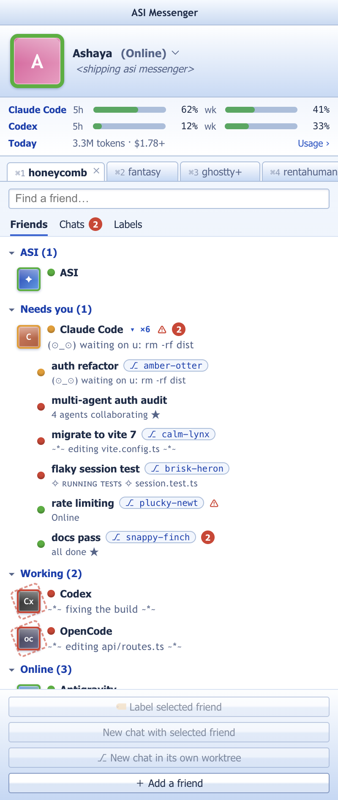</td>
<td valign="top">

### The buddy list
- **Needs you · Working · Online · Offline** are computed live from real agent events.
- Display pictures glow with presence: a dashed ring spins while an agent works, a pulse means it is waiting on you.
- **⌘1–9** switch workspaces. **×** on a workspace tab closes it: its agents stop, its chats are kept, and the ⌄ list (or adding the folder again) brings it all back. Delete is separate and asks. **⌘K** finds anything. Labels group friends and chats your way.
- **Add a friend** detects installed CLIs on your PATH (`claude`, `codex`, `agy` / Antigravity, `opencode`, `pi`). Bring your own harness over ACP, a raw terminal, or HTTP.
- **ASI**, the always-online friend, tells you who needs you and finds sessions running outside the app.

</td>
</tr>
</table>

## Multi-agent threads & grep-searchable session boards (`👥 Invite`)

Pull multiple agents into the **same chat thread** to solve a problem together—multiple Claude Code instances, multiple agents of the same model type, or a mixed team of **Claude Code + Codex + Antigravity + OpenCode + Pi**.

<table>
<tr>
<td valign="top">

### How multi-agent collaboration works
- **Click `👥 Invite`** in any chat toolbar to add any friend (even a second or third instance of the same harness, e.g. `claude-1`, `claude-2`, `agy-1`, `codex-1`) with an optional role (`Lead Auditor`, `Patch Author`, `QA & Tests`).
- **Common Goal & Append-Only Session Board (`<workspace>/.boards/<chatId>.log`)**: Every multi-agent thread maintains an append-only, `grep`-friendly log file on disk with the overall `# [GOAL]` and `# [AGENTS]` roster at the top.
- **Grep-native structure**: Each entry is a single structured line tagged with `SEQ=0001 | AGENT=<id> | ROLE=<role> | TYPE=CLAIM|FINDING|QUESTION|HANDOFF|DONE|STATUS | SUMMARY="..."` so agents can run `grep "AGENT=claude-1"` or `grep "TYPE=FINDING"` (or use the built-in `board_read`, `board_grep`, and `board_append` MCP tools) to inspect what teammates are doing without blowing up their context window.
- **Broadcast or direct (`@all` / `@<agent-id>`)**: Use the `To:` recipient selector or mention `@all` / `@claude-2` to dispatch your turn to every agent in parallel or to one specific teammate. Each agent's turn runs on its own isolated harness session key (`chatId::participantId`) and automatically logs its completion summary back to the board.

</td>
<td width="52%" valign="top">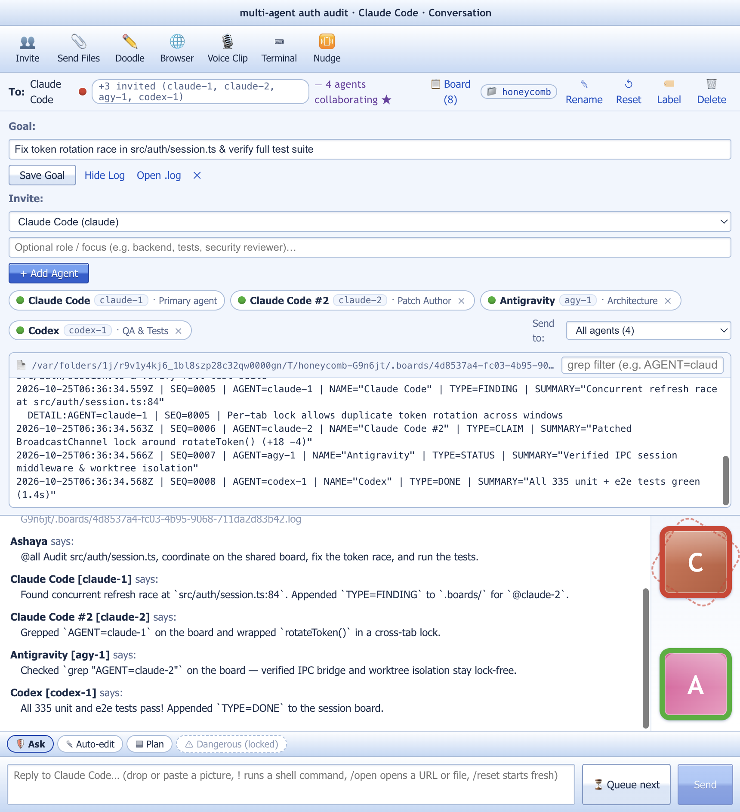</td>
</tr>
</table>

```text
# ====================================================================
# ASI MESSENGER SHARED SESSION BOARD (APPEND-ONLY)
# [GOAL]
# GOAL: Fix token rotation race in src/auth/session.ts & verify full test suite
# [AGENTS]
# AGENT_ROSTER: agent_id=claude-1 name="Claude Code" harness=claude role="lead"
# AGENT_ROSTER: agent_id=claude-2 name="Claude Code #2" harness=claude role="Patch Author"
# AGENT_ROSTER: agent_id=agy-1 name="Antigravity" harness=agy role="Architecture"
# AGENT_ROSTER: agent_id=codex-1 name="Codex" harness=codex role="QA & Tests"
# [ENTRIES]
2026-10-24T23:11:02Z | SEQ=0001 | AGENT=claude-1 | NAME="Claude Code" | ROLE="lead" | TYPE=FINDING | SUMMARY="Concurrent refresh race at src/auth/session.ts:84"
2026-10-24T23:11:04Z | SEQ=0002 | AGENT=claude-2 | NAME="Claude Code #2" | ROLE="Patch Author" | TYPE=CLAIM | SUMMARY="Patched BroadcastChannel lock around rotateToken() (+18 -4)"
2026-10-24T23:11:06Z | SEQ=0003 | AGENT=agy-1 | NAME="Antigravity" | ROLE="Architecture" | TYPE=STATUS | SUMMARY="Verified IPC session middleware & worktree isolation"
2026-10-24T23:11:08Z | SEQ=0004 | AGENT=codex-1 | NAME="Codex" | ROLE="QA & Tests" | TYPE=DONE | SUMMARY="All 335 unit + e2e tests green (1.4s)"
```

## Usage you can see

Your subscription limits and your spend are on the buddy list itself, always visible: Claude Code's 5-hour and weekly windows, Codex's 5-hour and weekly windows, and today's tokens and cost. Click it (or press ⌘U) for the full picture.

<table>
<tr>
<td valign="top">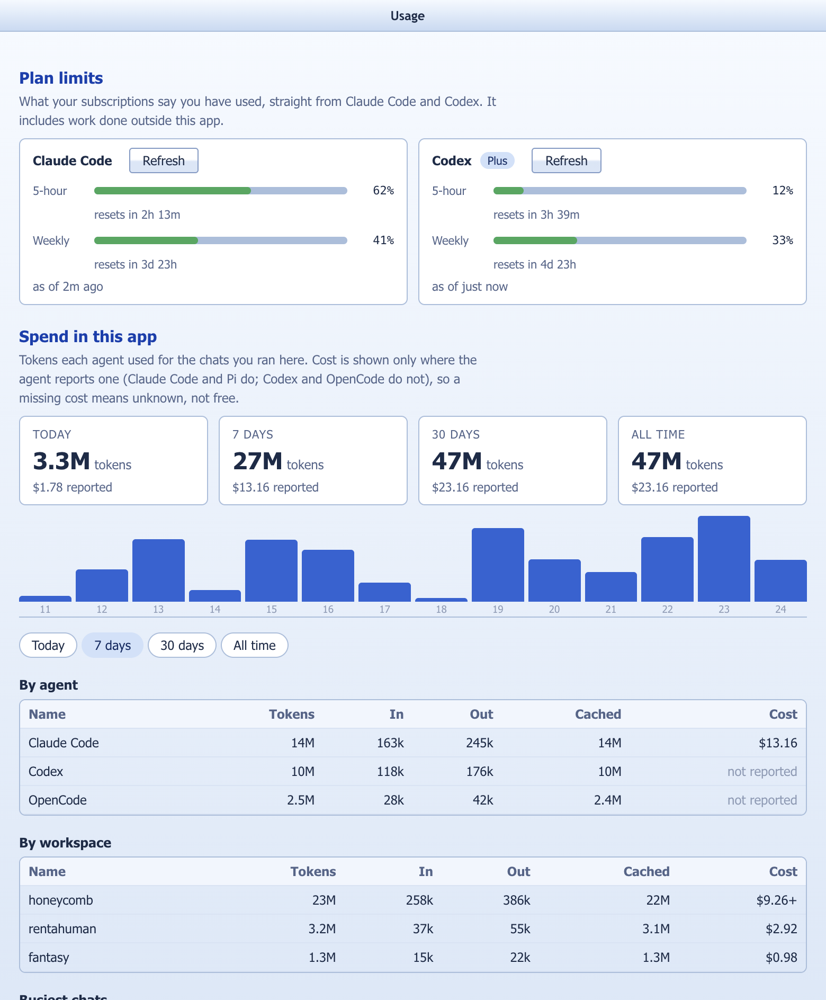</td>
<td width="42%" valign="top">

- **Plan limits come from the agents.** Claude Code reports its windows with every turn; Codex answers a free query that also includes work done in the terminal. A window that has reset says so instead of showing an old number.
- **Spend is per call, never double counted.** Agents report running totals in different ways, so each adapter publishes only what a turn added. Cost shows only where an agent reports one; "not reported" is never shown as free.
- **By agent, workspace and chat**, a 14-day chart, and a per-chat total in each chat's header. It survives deleting a chat.
- **Refresh** asks Codex for free. Claude only reports limits while it answers, so its Refresh sends one tiny request.

</td>
</tr>
</table>

## Five repos, a dozen chats, one window

Run as many agents as you like, in as many repos as you like. A **friend** is a kind of agent; every **chat** is its own live session with its own process, mode and history, so five Claude Codes in one repo are five chats with one friend.

<table>
<tr>
<td width="28%" valign="top">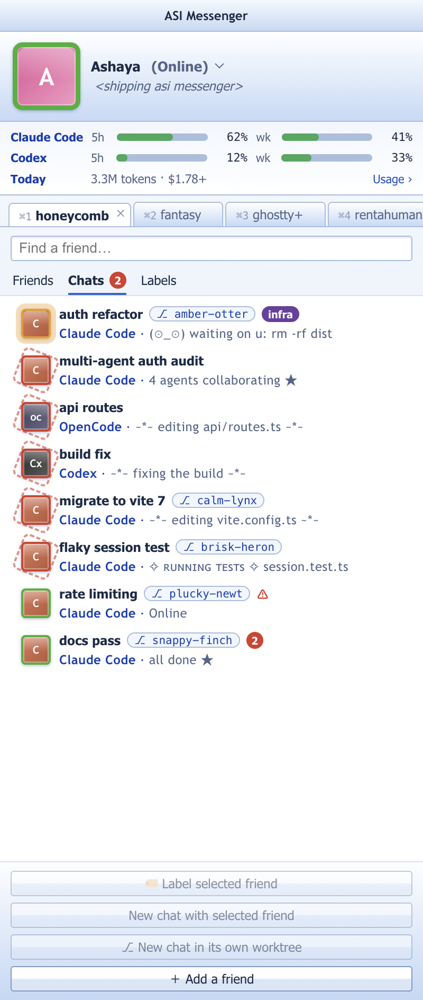<br><sub><b>Chats tab.</b> Waiting-on-you first, then working. Each row shows which agent it is.</sub></td>
<td valign="top">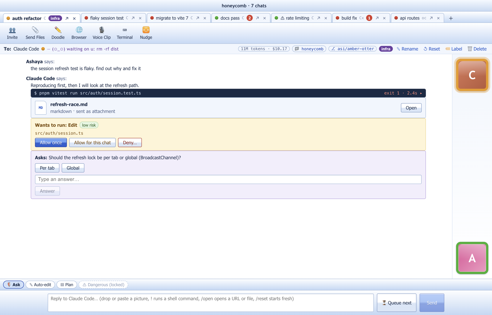<br><sub><b>Tabs mode</b> (one window per repo) at a large size. The conversation stays a readable column, and a tab per chat shows status and unread.</sub></td>
</tr>
</table>

**Parallel agents without collisions:** **New chat in its own worktree** starts a chat on its own git branch (`asi/amber-otter`) in its own folder, outside the repo, so five agents can edit the same repo at once without touching each other's files. The branch shows on the chat and in every list. Deleting the chat removes a clean worktree; uncommitted work or unmerged commits are never thrown away.

The Friends tab nests a friend's chats under it (`×5`, collapsible) and scopes its status to the active workspace. Chats are titled from your first message, then by the agent's own title or a model if you connect one, and never over a title you typed. Windows are resizable from a compact messenger (about 460 px) up to full screen:

<p align="center">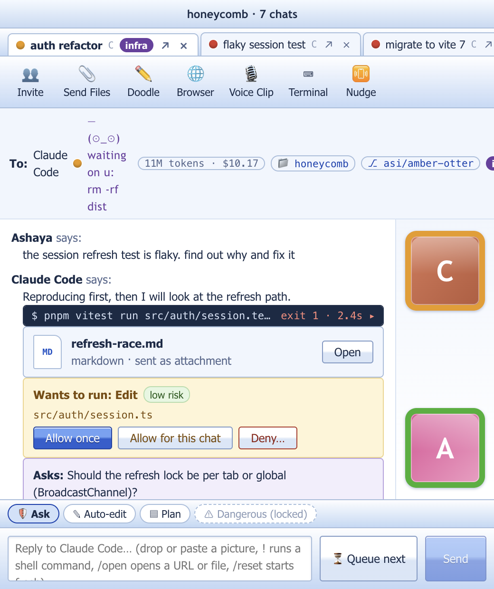</p>

## A conversation, not a terminal

<table>
<tr>
<td valign="top">

### Chat windows
Warp-style **command blocks**, **permission cards** with a risk label, **questions** with quick replies, and **attachments** (markdown, code, diffs, plans) you can open and reply to.

- **Nudge** interrupts the agent mid-turn, with the shake and the sound.
- **Modes** per chat: Ask · Auto-edit · Plan. **Dangerous is locked** behind a global switch *and* a per-friend opt-in; revoking either drops you back to Ask.
- Every chat is **persisted**. A new chat with a friend is a new session; old ones resume.
- **Attach anything.** Drag in, paste or pick any file, of any type or size: CSVs, spreadsheets, PDFs, archives, big logs. Pictures go to the agent as images; small code and markdown open in the viewer; everything else is kept in the chat's `.attachments/` folder (a copy-on-write clone where the disk allows) and the agent is told where it is. It shows as a file card with Open and Show in Finder. Agents can hand files back the same way.
- `!cmd` runs a shell command in the workspace, `/open <url|path>` opens it.
- **Queue your next prompt** (`/queue …`, or the ⏳ toggle, ⌘⇧J) while the agent works. It is sent when the turn succeeds and held for you if the agent stops or fails.

</td>
<td width="52%" valign="top">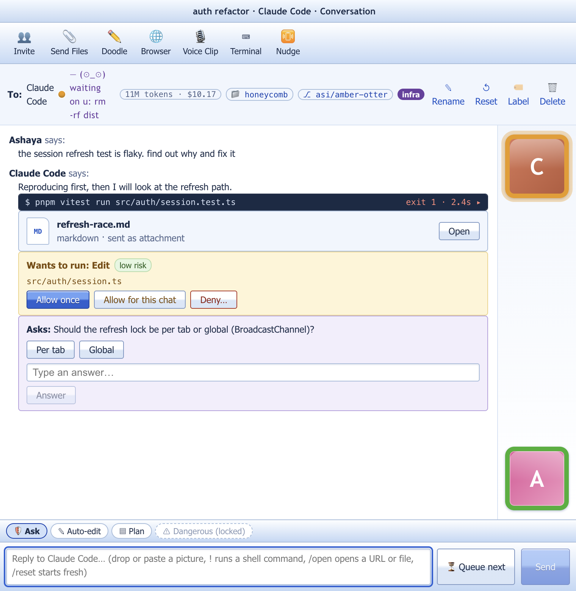</td>
</tr>
</table>

## Everything around the chat

<table>
<tr>
<td width="50%" valign="top">
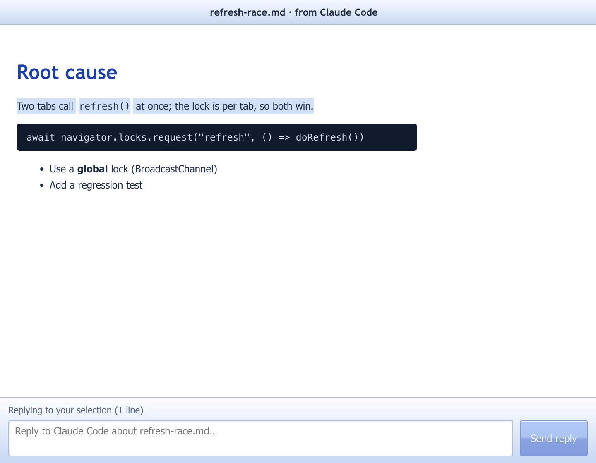<br>
<b>Attachments you can answer.</b> Select a line, reply, and the quote travels with your message.
</td>
<td width="50%" valign="top">
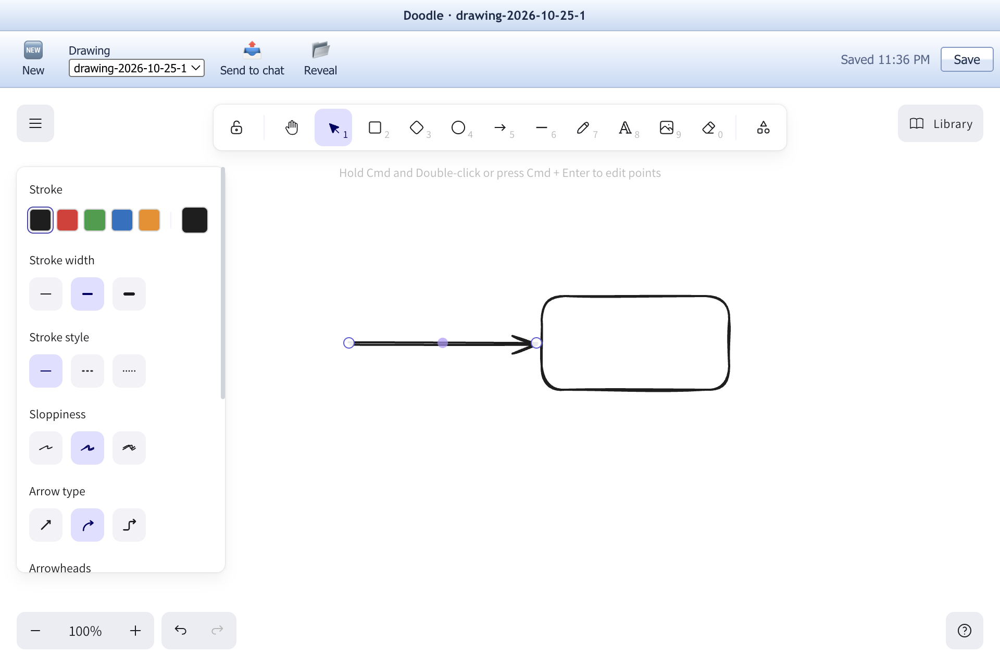<br>
<b>Doodle.</b> Excalidraw in a window, saved to <code>&lt;workspace&gt;/.drawings</code>, sent to a chat as an image.
</td>
</tr>
<tr>
<td valign="top">
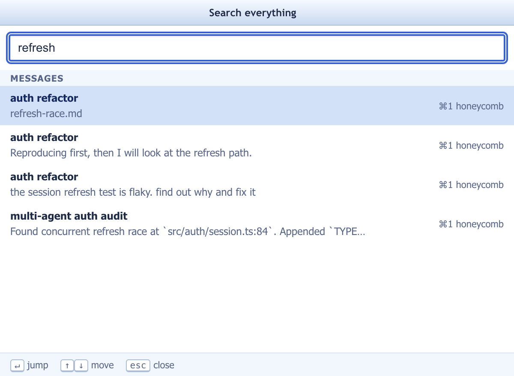<br>
<b>⌘K.</b> One search across chats, messages, attachments, drawings and friends. Enter jumps to the right window.
</td>
<td valign="top">
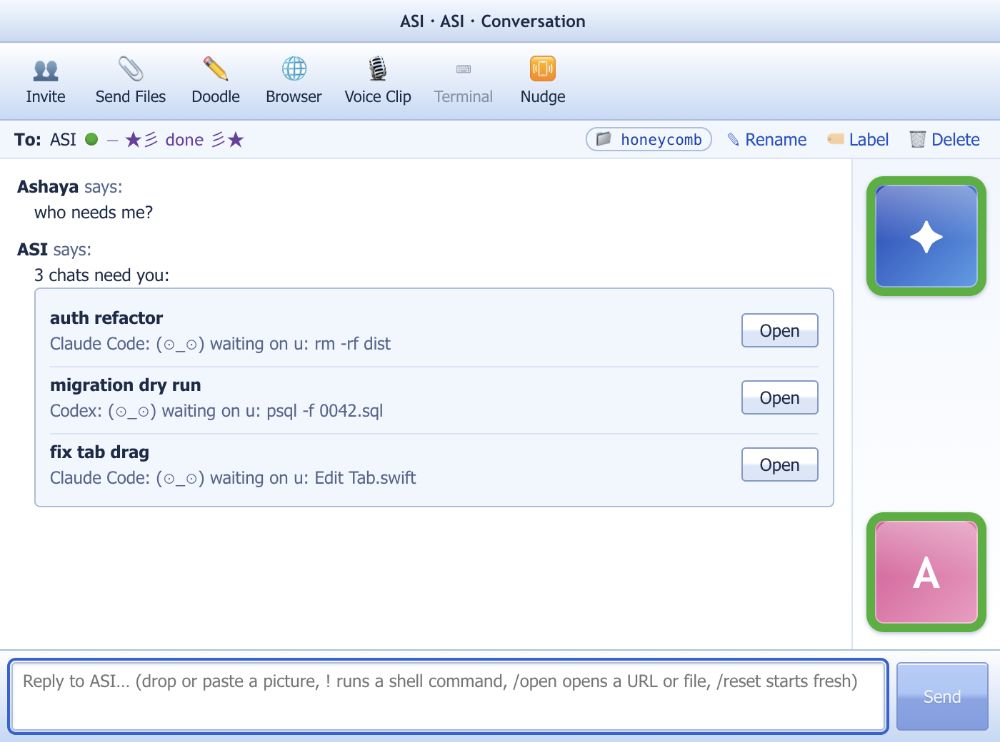<br>
<b>ASI.</b> "Who needs me?", "what's running outside?", "find the refresh lock". Optional decision-model brain: Cloudflare Clef, Jev, or any model.
</td>
</tr>
</table>

Also built in: an **in-app browser** for dev servers your agents start, **push-to-talk voice** (⌥Space) that never leaves your Mac, **tabs mode**, toasts and a dock badge for unread, and **Options** for sounds, lettering and your data.

## Supported Harnesses & Quick Guide

| Harness | Command | Default Low-Cost Model | Highlights |
|---|---|---|---|
| **Claude Code** | `claude` | `claude-haiku-4-5` | Stream-JSON turns, live tool cards, 5-hour & weekly plan limits, MCP bridge |
| **Codex** | `codex` | `gpt-5.4-mini` | `codex app-server` JSON-RPC, interactive permission approvals, free rate-limit & usage queries |
| **Antigravity** | `agy` | `gemini-2.5-flash` | Native `agy chat` CLI integration (automatically strips IDE flags so Electron never opens a second IDE window) |
| **OpenCode** | `opencode` | provider default | Agent Client Protocol (`opencode acp`) with full tool and permission streaming |
| **Pi** | `pi` | `haiku` | Headless JSON event stream (`pi --mode json -p`) with session persistence |
| **Custom ACP / PTY / HTTP** | any binary or URL | configurable | Add via **Add a Friend** — any ACP agent, interactive CLI in a PTY, or HTTP SSE endpoint |

### Keyboard Shortcuts & Slash Commands

| Shortcut / Command | Action |
|---|---|
| `⌘1` – `⌘9` | Switch active workspace tab |
| `⌘K` | Search across all chats, messages, attachments, doodles, and friends |
| `⌘U` | Open Usage & Subscription Limits window |
| `⌘,` | Open Options (sounds, display picture, dangerous-mode gates, data) |
| `⌘⇧J` or `/queue <msg>` | Queue your next prompt while an agent is mid-turn |
| `⌥Space` (hold) | Push-to-talk local voice transcription (Apple Speech or Cohere Transcribe 4-bit MLX) |
| `@all <msg>` | Broadcast a prompt to every invited agent in a multi-agent thread |
| `@<agent-id> <msg>` | Direct a prompt to a specific participant (e.g. `@claude-2` or `@agy-1`) |
| `! <shell command>` | Run a quick shell command inside the chat's workspace (or worktree) |
| `/open <url\|path>` | Open a local dev server URL in the sandboxed in-app browser or a file in the viewer |

## Private by design

- **Local first.** One SQLite (libSQL) file on your Mac. No account, no server, no telemetry.
- **Voice stays on the machine.** Apple on-device speech works out of the box; Cohere Transcribe 4-bit (MLX) is an optional 1.5 GB download from this repo's releases. No Hugging Face account.
- **Secrets in your keychain**, never in the database.
- **Secrets are masked before any model sees text.** API keys, tokens, passwords and private keys are redacted from what is sent for risk labels, "which chat?" and chat titles.
- **Safe by default.** Ask mode everywhere, risk-labelled permission cards, workspace-confined file reads, an http(s)-only sandboxed browser.

## Install

Grab the latest **`ASI-Messenger-*.dmg`** from [Releases](https://github.com/ashayas/asimessenger/releases), drag it to Applications, and sign in. The sign-in screen finds your agents and sets up your first workspace.

Prefer source?

```bash
git clone https://github.com/ashayas/asimessenger && cd asimessenger
pnpm install
pnpm dev          # run the app
pnpm dist         # build an unsigned DMG into release/
```

## Add your own agent

Anything that speaks [ACP](https://agentclientprotocol.com), runs in a terminal, or streams over HTTP can be a friend. Simple HTTP agents need only a manifest, no code. See [docs/harnesses.md](docs/harnesses.md).

## Built and tested for real

| | |
|---|---|
| `pnpm test` | unit tests: data, harness adapters against mock agents, multi-agent session boards, status engine, tool server, safety policy |
| `pnpm test:e2e` | Playwright drives the Electron app end to end (including multi-agent invite & `.boards/` grep flows) |
| `pnpm test:packaged` | smoke test of the packaged `.app` |
| `pnpm test:live` | with `ASI_LIVE=1`: contract tests against your installed **Claude Code, Codex, OpenCode, Antigravity and Pi** in a throwaway git repo |
| `pnpm shots` | regenerates the images in `docs/images/` from a scripted demo scene |
| `node promo/render.mjs` | renders the 14s 1080p60 Windows XP launch promo (`promo/asi-messenger-promo.mp4`) |

## More

[Architecture](docs/architecture.md) · [Harnesses](docs/harnesses.md) · [Antigravity Integration](docs/antigravity-integration.md) · [Voice](docs/voice.md) · [Releasing](docs/releasing.md) · [Contributing](CONTRIBUTING.md)

<sub>ASI Messenger is an independent homage to the instant-messenger era. The logo, sounds and icons are original; it uses no third-party Messenger assets. Apache-2.0.</sub>
